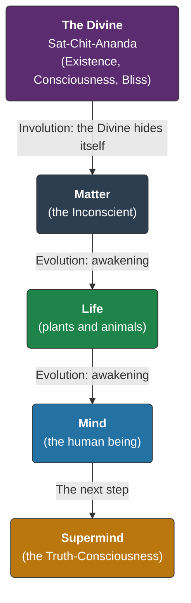
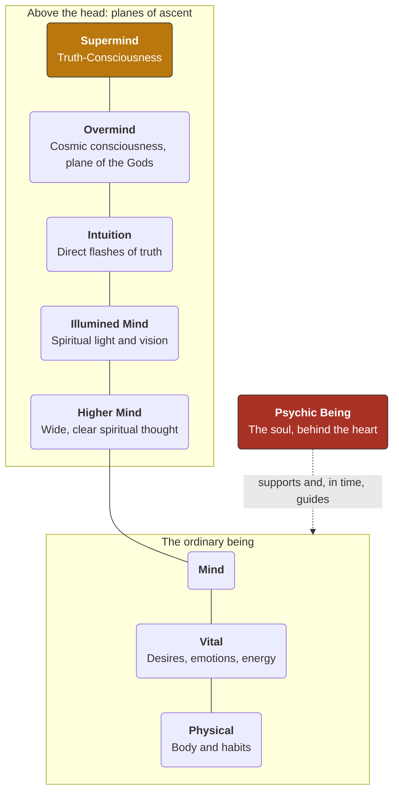
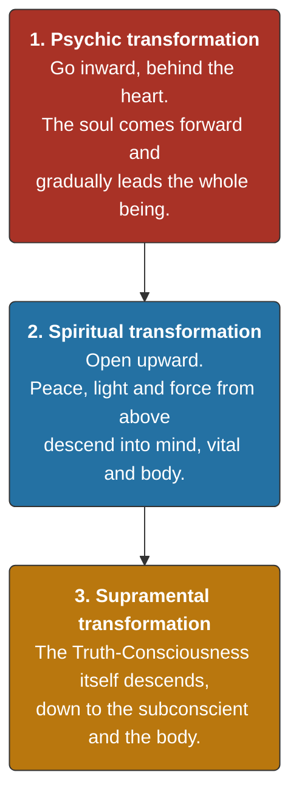

# The Divine Transfiguration

> *"Man is a transitional being; he is not final."*
> — **Sri Aurobindo** (*The Hour of God*)

> **About this compilation.** Everything of value here belongs to Sri
> Aurobindo and The Mother. This post was compiled by AI: a first draft was
> generated by Gemini from my prompts, then checked, corrected and restructured
> with Claude. Sri Aurobindo's collected works run to more than thirty volumes,
> and *Savitri* alone has nearly 24,000 lines; it is easy for a seeker to lose
> the thread. This is an attempt by a human and AI together to offer that
> thread. It is a doorway, not a substitute. Wherever this text and the
> originals differ, trust the originals.

---

## How to read this

The path is laid out in seven short steps. Each one ends with a single line
to **carry with you**. If you remember only those seven lines, you have the
whole map.

1. **The Vision** - why this yoga exists
2. **The Map** - what you are made of
3. **The Way** - the three movements, and their order
4. **The Two Forces** - your aspiration and the Mother's Grace
5. **Daily Practice** - what to actually do
6. **When It Gets Hard** - the difficulties every sadhak meets
7. **Where to Read Next** - a gentle path into the original works

Go slowly. Take one step at a time.

### First, who were they?

**Sri Aurobindo** (1872–1950) was a scholar, poet and leader of India's
freedom movement. In 1910 he withdrew from politics to Pondicherry to give
himself entirely to yoga. **The Mother** (Mirra Alfassa, 1878–1973), born in
Paris, joined him there in 1920. Sri Aurobindo regarded her as his equal in
the yoga. She built and guided the Sri Aurobindo Ashram, and later founded
Auroville.

---

## Step 1. The Vision - Evolution of Consciousness

Many schools of Indian thought - Mayavada Vedanta most famously, and the
Buddhist ideal of Nirvana - see the final goal as release *from* the world.
Sri Aurobindo honoured these realisations, but held that they are not the
end. His aim is not escape from life, but **the divine transformation of life
itself, here on Earth**.

The foundation is a simple, vast idea, set out in *The Life Divine*:

* **Involution.** The Divine - infinite Existence, Consciousness and Bliss -
  veiled itself step by step until it was hidden in apparently unconscious
  Matter. Matter is not empty of the Divine; it is the Divine asleep.
* **Evolution.** Because the Divine is hidden in Matter, it presses to
  emerge. Matter awoke into Life; Life awoke into Mind.
* **The next step.** Mind is not the summit. As the animal was a stage on the
  way to the human, the human is a stage on the way to a spiritual and
  supramental being.

> **Carry with you:** *You are not here to escape the world, but to take part
> in its awakening.*

---

## Step 2. The Map - What You Are Made Of

You cannot transform what you do not understand. In *Letters on Yoga*, Sri
Aurobindo describes the being along two directions: **inward** (depth, behind
the surface) and **upward** (planes of consciousness above the ordinary mind).

### Inward: the depths

* **The outer being** - the surface mind, vital and physical we usually take
  to be "me": thoughts, desires, moods and habits.
* **The inner being** - behind the surface, an inner mind, inner vital and
  subtle physical, wider and more open to universal forces.
* **The psychic being** - deepest of all, behind the heart centre. Sri
  Aurobindo distinguishes the **psychic entity**, the divine spark itself,
  from the **psychic being**, the soul-personality that grows around it from
  life to life. It has a spontaneous sense of what is true, good and
  beautiful, and an inborn turning towards the Divine.

### Upward: the planes above mind

* **Higher Mind** - large, clear spiritual thought.
* **Illumined Mind** - spiritual light and vision rather than thought.
* **Intuition** - truth seen directly, in flashes.
* **Overmind** - a cosmic consciousness, the plane of the Gods. Vast, but
  it is also where the one Truth first divides into many separate truths.
* **Supermind** (*Vijnana*) - the Truth-Consciousness, where the whole is
  seen and known at once, with the power to transform even Matter.

> **Carry with you:** *Your true self lies behind the heart, and there is far
> more above the mind than the mind can know.*

---

## Step 3. The Way - Three Movements, in Order

Integral Yoga (*Purna Yoga*) does not leave the body behind. It seeks to
bring the higher consciousness down into ordinary life. Sri Aurobindo
describes three movements, and **the order matters**.

* **Psychic transformation.** The soul comes to the front and begins to
  govern thoughts, feelings and actions, quietly setting each in its right
  place.
* **Spiritual transformation.** The being opens above. Peace, silence, light
  and force descend and widen the whole nature.
* **Supramental transformation.** The final change, reaching even the
  subconscient and the cells of the body.

**A caution Sri Aurobindo repeated often:** do not make the Supermind your
immediate aim. In his letters he warns that sadhaks who chase supramental
experience usually mistake lower or vital experiences for it, and that the
ego quickly takes hold of them. The practical work for the sadhak is the
first movement - letting the psychic being come forward - with openness to
the second. The rest is the Divine's work, in its own time.

> **Carry with you:** *Begin in the heart. The heights will come when the
> foundation is ready.*

---

## Step 4. The Two Forces - Aspiration and Grace

Sri Aurobindo opens his small book *The Mother* with these words:

> *"There are two powers that alone can effect in their conjunction the great
> and difficult thing which is the aim of our endeavour, a fixed and
> unfailing aspiration that calls from below and a supreme Grace from above
> that answers."*

Human effort alone cannot do this yoga; the ego cannot dissolve itself. Nor
does Grace act on someone who does not call. Both are needed.

In the same book, Sri Aurobindo describes **The Mother** as the conscious
Force of the Divine - the Divine Shakti - through whom the transformation is
actually done. He names four of her great aspects:

* **Maheshwari** - wisdom and wideness
* **Mahakali** - strength and swiftness
* **Mahalakshmi** - harmony and beauty
* **Mahasaraswati** - perfection in work, down to the smallest detail

To open to The Mother is to let her Force work in you, rather than trying to
change yourself by strain alone.

> **Carry with you:** *Call sincerely from below; the answer comes from
> above.*

---

## Step 5. Daily Practice - What To Actually Do

Sri Aurobindo wrote that, in the right view, **all life is Yoga**. There is no
need to leave work or family. The office, the kitchen and the playground are
all places of sadhana.

### The foundation: sincerity

The Mother returned to this again and again: sincerity is the first and
indispensable condition. To be sincere is to want the Divine with *every*
part of yourself, without a hidden part that wants something else, and to
not deceive yourself about your own motives. Everything below rests on it.

### The core formula

In *The Mother*, Sri Aurobindo names three things the sadhak does:

* **Aspiration** (*abhipsa*) - a quiet, steady call in the heart for the
  Divine, for light, peace and truth.
* **Rejection** - calmly refusing your consent to desire, anger, falsehood,
  restlessness and ego whenever they rise. Not fighting them with violence;
  simply not agreeing with them.
* **Surrender** (*samarpan*) - offering everything you are and do - thoughts,
  feelings, work and body - to the Divine.

### Simple practices for a busy life

* **Begin and end the day by turning inward.** Sit quietly for a few minutes.
  Bring your attention to the centre of the chest, behind the heart, and
  call. No technique is needed beyond sincerity. Sri Aurobindo advised most
  sadhaks to concentrate in the heart; concentration above the head was for
  those to whom it came naturally.
* **Step back.** During the day, take a step behind your surface mind and
  watch thoughts and feelings pass, without being carried by them. Even a
  moment of this changes the quality of the day.
* **Offer your work.** Before a task, offer it. During it, do it as well as
  you can, as if for the Divine. After it, offer the result - success or
  failure.
* **Cultivate equality** (*samata*). Meet praise and blame, gain and loss,
  with the same inner steadiness. This does not mean not caring; it means
  not being shaken.

### The body is part of the yoga

The Mother gave great importance to physical education - games, gymnastics,
athletics, good food and rest. Her talks to Ashram children on the
playground (*Questions and Answers*) and her writings in *On Education*
explain why: the body is not an obstacle to the spirit, but the instrument
that must become strong, supple and free of inertia (*tamas*) to hold more
light.

> **Carry with you:** *Be sincere, offer everything, and keep the body
> strong.*

---

## Step 6. When It Gets Hard

Every sadhak meets difficulties. Sri Aurobindo's letters are full of them,
and full of reassurance. Knowing them in advance helps.

* **The vital revolts.** Desires and moods that seemed gone return with
  force. This is normal: the light is reaching parts that were hidden.
  Persist calmly.
* **Dry periods.** Weeks or months with no felt progress. Sri Aurobindo
  explained that much of the work goes on behind the veil, out of sight.
* **Depression and doubt.** He treated these as passing attacks, to be
  neither believed nor fed. Do not judge the whole path by a bad week.
* **The ego steals experiences.** A beautiful experience can quickly become
  "my achievement". Offer it too, and go on.
* **Hurry.** Wanting results fast is itself a form of desire. The Mother
  advised an endless patience with oneself.

> **Carry with you:** *Difficulties are part of the path, not proof that you
> have left it.*

---

## Step 7. Where To Read Next

The full works are vast. Do not begin with *The Life Divine*. A gentle order:

1. ***The Mother*** (Sri Aurobindo) - a short book; the heart of the practice.
2. ***Bases of Yoga*** (Sri Aurobindo) - short extracts from his letters on
   calm, faith, difficulties and the body. The best practical companion.
3. ***Questions and Answers*** (The Mother) - simple, direct talks on daily
   life and inner discipline.
4. ***Letters on Yoga*** (Sri Aurobindo, CWSA Vols. 28–31) - the detailed
   map of the being, the planes, and the difficulties of sadhana.
5. ***The Synthesis of Yoga*** (Sri Aurobindo) - how the yogas of works,
   knowledge, love and self-perfection come together.
6. ***The Life Divine*** (Sri Aurobindo) - the full philosophy of involution,
   evolution and the Supermind.
7. ***Savitri: A Legend and a Symbol*** (Sri Aurobindo) - the epic poem of
   the soul's journey and the conquest of death. Read slowly, a few lines at a
   time, as a mantra.

For the body and education, see The Mother's ***On Education***. Some readers
also turn to ***Mother's Agenda***, the record of her later yoga of the cells
as kept by Satprem. It is not part of her *Collected Works*, and is best read
once the foundations above are familiar.

The *Complete Works of Sri Aurobindo* and the *Collected Works of The Mother*
can be read free online at [Incarnate Word](https://incarnateword.in) and the
[Sri Aurobindo Ashram](https://www.sriaurobindoashram.org) website.

> **Carry with you:** *Read a little, practise a lot.*

---

## The Seven Lines

1. You are not here to escape the world, but to take part in its awakening.
2. Your true self lies behind the heart, and there is far more above the mind
   than the mind can know.
3. Begin in the heart. The heights will come when the foundation is ready.
4. Call sincerely from below; the answer comes from above.
5. Be sincere, offer everything, and keep the body strong.
6. Difficulties are part of the path, not proof that you have left it.
7. Read a little, practise a lot.

> *"They who choose the Infinite have been chosen by the Infinite."*
> — **Sri Aurobindo**

---

*An earlier, more personal post about our course and encounter with Sri
Aurobindo's work is [here]({{ site.baseurl }}).*

*This text was compiled by AI (Gemini and Claude) under human direction and
review. All credit belongs to Sri Aurobindo and The Mother; any errors are
ours. If you notice one, please write in so it can be corrected.*

*Version {{ page.version }} · 22 October 2026*

