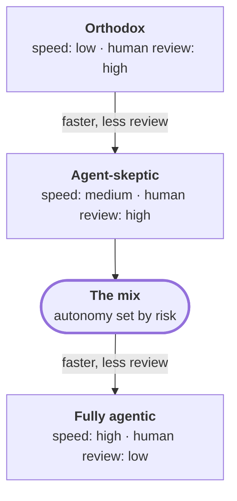

Teams are responding to agents in three broad ways. These are not labels
for people, and I do not think any of them is foolish. Each one is a
reasonable answer to a real fear. Most teams sit somewhere between them,
and a single company can have all three at once, sometimes on the same
floor.





The first is the **orthodox team**. It works the way good teams worked five
years ago. Requirements are written, estimated, broken into tickets, built
by hand, reviewed by hand, tested in a staging environment, and released on
a schedule. AI may be allowed for searching documentation or drafting an
email, but not for writing code that ships. The reasons are often sound:
concerns about data leaving the company, about licensing, about code nobody
fully understands. In a regulated business these concerns are not paranoia.
The orthodox team is predictable, and its process produces evidence almost
by accident, because every change has a human author and a human reviewer.
It is also *the slowest of the three*, and it is getting slower relative to
everyone else.

The second is the **agent-skeptic team**. It uses AI in small doses: code
completion in the editor, a chat window for a stubborn regular expression,
a generated first draft of a unit test. Engineers who like the tools use
them; engineers who do not, ignore them. The process around the code does
not change. Tickets, reviews, and releases look exactly as they did before.
In my experience this is the most common pattern, and it is a sensible
place to start. Its weakness is that it treats a change in how code is
produced as if it were only a change in typing speed. *The individual
engineer gets a little faster. The team, mostly, does not.*

The third is the **fully agentic team**. Here agents do most of the work
end to end. A person describes an outcome, and agents plan it, write the
code, write the tests, and open the pull request. In the boldest setups
they also merge and deploy to production when the checks pass. Humans step
in when something breaks or when the agents ask. These teams are fast in a
way the other two cannot match, and they are worth learning from. They are
also where one question is hardest to answer: *who decided this, and where
is that written down?* Too often the honest answer is nobody, and nowhere.

It helps to place these on a line. As you move from orthodox to fully
agentic, speed goes up and human review, as a share of what ships, goes
down. Neither end is safe. One end is protected from agent mistakes but
exposed to being too slow to matter. The other end is fast but exposed to
mistakes nobody saw. **The mix I argue for sits between them**, but not at
a fixed point. It moves depending on what is being changed.

A simple way to place your own team is to ask three questions about the
last change that reached customers. *Who wrote the code? Who checked it?
Who decided it could go live?* If the answer to all three is a person, you
are near the orthodox end, whatever tools people use in their editors. If
an agent wrote it and a person checked and released it, you are moving
toward the middle. If an agent did all three, you are at the agentic end,
whether or not anyone chose to be there.

I have seen all three kinds of team at work, and each taught me something.
The next chapter is about what they taught me.

I am not saying the orthodox team should become fully agentic, or that the
fully agentic team should slow to orthodox pace. Each kind of team has made
a trade, usually without saying it out loud. The rest of this essay tries
to make that trade explicit, so that a team *chooses* its position on the
line instead of drifting into it. To do that, it helps to look closely at
where each kind of team breaks.
