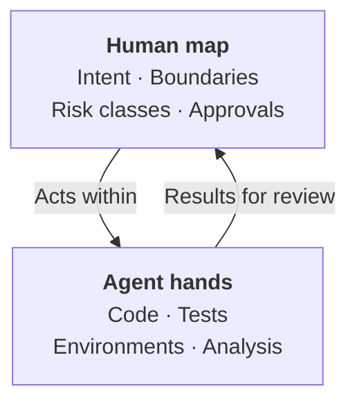

I find it useful to think of software work as two layers. The first layer
is **the map**: what we are trying to achieve, what we are deliberately not
doing, how risky each part is, and who has to agree before something
changes. The second layer is **the hands**: writing the code, writing and
running the tests, setting up environments, digging through logs, comparing
options, and producing evidence that the work does what the map says.





The map has four parts. Intent is the outcome we want, stated in terms a
customer or an auditor would recognise, not in terms of code. Boundaries
are the non-goals and constraints: what this change must not do, the data
it must not touch, the behaviour that must stay the same. Risk classes
say how much damage a mistake in each part could cause, which in turn
decides how much freedom the agent gets there. Approvals say who has to
look at what, and when, before it reaches a customer.

The hands also have four parts. Code is the obvious one. Tests are the
executable form of the map's boundaries. Environments are where the work
is tried before it is trusted. Analysis is everything else that used to
eat an engineer's afternoon: reading logs, tracing a slow request,
comparing two libraries, summarising what changed.

My view, from my own experience, is that agents are now very good at the
hands and still unreliable at the map. That is not because they lack
intelligence. It is because the map depends on things that are rarely
written down: why a feature exists, which customer complaint started it,
which conversation with compliance shaped it, which past incident made a
rule non-negotiable. *An agent can read what we wrote. It cannot read what
we assumed.* And there is a deeper reason. **Humans hold the map** because humans are accountable for it, and accountability cannot be handed to
something that cannot be held to account.

The two layers connect in a loop. The agent acts within the map: it is
given the intent, the boundaries, and the risk class before it starts, and
it is not allowed to cross them. The agent then returns results for review: code, test results, environment output, and a plain account of
what it did and why. A person reads that against the map, approves it or
sends it back, and sometimes updates the map itself, because the work
revealed something nobody knew at the start.

This loop also answers the review problem from the [previous chapter]({{ '/human-map-agent-hands/02-three-kinds-of-teams/' | relative_url }}). A
reviewer facing a large diff with no map can only ask "does this code look
right?", which is slow and easy to skim. A reviewer with a map can ask
sharper questions. Does the result match the intent? Did it cross a
boundary? Is the evidence enough for this risk class? The map turns review from reading code into **checking a claim**. That is why we now bring
reviewers in at the design stage, as the [previous chapter]({{ '/human-map-agent-hands/02-three-kinds-of-teams/' | relative_url }}) described: a
reviewer who helped draw the map can check the work against it.

What does a map look like in practice? Smaller than people expect. Here is
a generic example for an ordinary change:

> **Intent:** Customers can download a statement of their transactions for
> any date range, as a PDF, from the app.
>
> **Non-goals:** No change to how transactions are stored. No email
> delivery. No statements for closed accounts in this change.
>
> **Boundaries:** The statement shows only the requesting customer's data.
> No personal data in logs. The existing statement API keeps working.
>
> **Risk class:** Propose and approve. It touches customer data but changes
> no money or records.
>
> **Approver:** The owner of the customer data domain.

That is enough for an agent to start, and for a reviewer to check the
result. A twenty-page specification that nobody finishes is not a map.

Does the map always come first? Not quite. When we do not yet know what to
build, an agent-built prototype is often the fastest way to find out, as
the story at the end of the [previous chapter]({{ '/human-map-agent-hands/02-three-kinds-of-teams/' | relative_url }}) showed. But that prototype is
a probe, not the product. It informs the map, and then it is rewritten or
thrown away. The map governs what ships, not what is tried.

This loop changes what a good engineer spends time on. Less time typing.
More time writing the map clearly enough that an agent cannot misread it,
and reviewing results with enough attention to notice when it has. I have
found that writing a good map is harder than writing the code was, and it
is the part teams most often skip.

We learned this in stages. We started by asking people to write product
requirements documents. Then we realised the documents were being written
by agents too. So we asked people to commit the prompts they had used, and
that showed us how much depth people were really putting into the design.
What works best is the simplest thing: ask the author to come and explain,
in person, what they have written. A conversation breaks the pretence that
generated text is the author's own thinking. As I wrote in [The Depth
Manifesto]({{ site.baseurl }}), an
AI-generated output is a draft, never a deliverable. A map you cannot explain is not your map.

Two things make the map real rather than ceremonial. It has to be
written, in the repository or next to it, so that an agent can read it
and an auditor can find it. A map that lives in a meeting or a chat thread
does not exist for either of them. I have long argued that [code explains
what, and docs explain
why]({{ site.baseurl }}). The map is that
"why", now written for an agent as well as for a person. My first attempt
at this for agents was a small protocol,
[PROTO]({{ site.baseurl }}), which kept the
plan and the context in files inside the repository. In the pilot I
described in [A Prompt Writes Code, a Process Ships
It]({{ site.baseurl }}), files became
the only shared memory between agents. And it has to be small enough to be read, by the agent before it starts and by the reviewer when it is done.

Once the map exists, the next question is how much freedom the hands get.
That depends on what is at stake.
