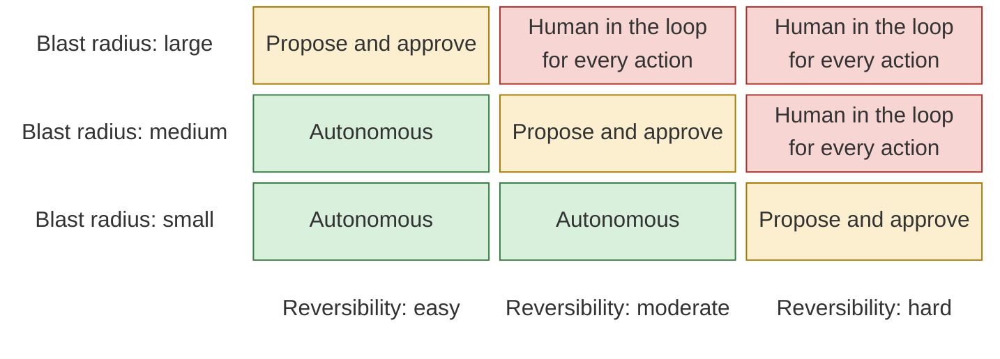

The question "should agents deploy to production?" has no single answer,
because production is not one thing. Fixing a spelling mistake on a help
page and changing how returns are calculated on a customer's investment are
both production changes. Treating them the same way is the mistake made by
both the orthodox team and the fully agentic team, in opposite directions.
One treats every change as dangerous. The other treats every change as
safe.

I use two questions to decide how much autonomy an agent gets for a given
change. **How reversible is it?** If it goes wrong, can we undo it in
minutes with no lasting effect, or does it leave marks that cannot be
removed, such as money moved, messages sent, data exposed or deleted, or
records filed? **How large is the blast radius?** If it goes wrong, does it
affect one internal screen, one team, or every customer and every
downstream system?





Put those two questions on a grid, with three levels on each, and three
tiers appear along the diagonal. Where a change is easy to reverse and its
blast radius is small, the agent can be **autonomous**: it makes the
change, runs the checks, and ships, and people review the record
afterwards. In the middle band, the agent works in **propose and approve**
mode: it does all the work, but a named person approves before it reaches
customers. Toward the far corner, where a change is hard to reverse or
touches many people, it is **human in the loop for every action**: the
agent can draft, analyse, and test, but each step that changes the real
world is taken or explicitly confirmed by a person. A simple rule
reproduces the grid. Score each question from one to three, and add them.
Two or three is autonomous, four is propose and approve, five or six is
human in the loop.

One subtlety matters more than the grid itself. *Reversibility is about the
failure, not the change.* Take the statement download from the [previous
chapter]({{ '/human-map-agent-hands/04-map-and-control/' | relative_url }}). The code can be rolled back in minutes. But if a bug ever shows one
customer another customer's transactions, that cannot be rolled back at
all. So the question is not "can we undo this deploy?" but "can we undo
the worst plausible thing this deploy could do?" That is why the statement
download is not autonomous, even though it moves no money: it sits in
propose and approve, and the boundary that each customer sees only their
own data is the first thing its tests must prove.

Some generic examples help. Internal documentation, test data generators,
and dashboards for the engineering team usually sit in the autonomous
corner. A new screen in a customer app, behind a feature flag and easy to
switch off, usually sits in propose and approve. Database migrations on
financial records, changes to how money moves, changes to what personal
data is collected or shared, and anything that produces a regulatory
filing sit firmly in the last tier.

In our own setup, autonomy is tiered by environment as much as by the
change. For some projects, changes to the lower environments, development
and UAT, are deployed automatically. For others, deployment no longer goes
through a central DevOps team: control sits with the people who own each
step of the SDLC, so a developer can deploy to UAT and QA can deploy to
staging. For production, we have not yet moved to fully autonomous
deployment. In practice, *full autonomy today exists only on the local
setup*. I count that as honest rather than slow. The autonomous corner of
the grid has to be earned with evidence, and for production we are not
there yet.

Three things make this work in practice. First, **the risk class is part
of the map**, decided by a person before the agent starts, not inferred by
the agent afterwards. Second, the tiers are *enforced by the system*, not
by good intentions: permissions, branch protections, deployment gates, and
credentials that the agent simply does not have in the higher tiers. An
agent that is told not to touch production but holds production
credentials is one confident mistake away from touching it. In the pilot I
described in [A Prompt Writes Code, a Process Ships
It]({{ site.baseurl }}), the rule was
that humans approve the irreversible, and each approval is committed the
moment it is made, pinned to the exact commit being shipped. Third, the
classification is revisited. A change that was risky when a system was new
can become routine once it has strong tests and a fast rollback. A change
that was routine can become risky when a regulation changes.

This model also gives a more honest answer to the fear behind the orthodox
team. The fear is that agents will do something irreversible that nobody
saw. The answer is not to keep agents out of everything. It is to keep
them out of irreversible, high-impact actions without a person, and to let
them move quickly everywhere else. In my experience, *most of a typical
codebase is not in the dangerous corner*, and treating all of it as if it
were is a choice to be slow where speed is safe.

Autonomy also depends on what the agent can see. An agent that cannot
observe the effect of its change is guessing, and guessing is only safe in
the smallest corner of the grid. That brings me to environments.
