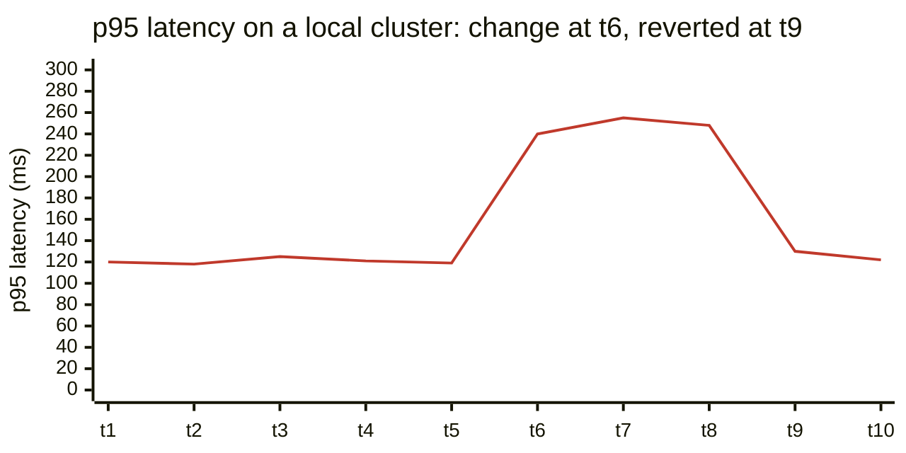

An agent that cannot see a running system is guessing. Without an
environment and a way to observe it, its only feedback is whether the code
compiles and whether its own tests pass, and that is not enough to trust it
with anything that matters. So I think of environments and observability
as **the agent's senses**. The better they are, the more autonomy is safe.

The first sense is an environment that matches production. For us that
means running the same orchestration locally that runs in production: a
local Kubernetes cluster on a laptop or a development machine, with the
same manifests, the same service boundaries, and the same shape of
configuration. Data, scale, and external integrations will always differ.
The point is that the usual mistakes show up on the laptop rather than in
front of a customer: a wrong port, a missing environment variable, a
service that assumes another is local, a migration that only works on an
empty database. This is an old lesson for me. When I worked on embedded
devices, nothing could be built without a good working local setup, and
that setup was a project in itself: development hardware and boards,
kernel compilation, all the way to RF shield rooms. We needed it to see
what our code actually did. Agents need the same thing, except that the
setup is now a cluster on a laptop instead of a lab.

The second sense is observability, locally. We run Grafana locally and
trace requests locally, so that when an agent changes a service, it can ask
the questions an on-call engineer would. Did latency change? Did errors
appear? Did a new query start running a thousand times per request? The
agent does not need a dashboard for this; it can query the same metrics,
logs, and traces that the dashboard reads.





The most useful habit this enables is simple: measure before, change,
measure after. Before the agent touches anything, it records how the
system behaves on the paths it is about to change. Afterwards, it runs the
same paths and compares. The chart shows what that catches: latency is
flat, a change lands, latency doubles, and it returns to normal once the
change is reverted. Without the "before", that jump is just a number. With
it, it is a finding. The agent's evidence changes too. Instead of "the
tests pass", it can say "the tests pass, latency and error rates on this
endpoint are unchanged, and here is the trace of one request through the
new path". An agent that can see the system can be asked to **prove its change**, not just describe it.

The senses are not only for engineers. Today, in our teams, the code is
still managed by developers and a few product managers. QA engineers do not
yet have working local setups; they test on shared servers such as UAT,
staging, and sometimes production. But anyone can discover an issue and
record it in the issue tracker, and the curious ones go further. They
switch into analysis mode and add the extra information that a developer,
and the developer's agents, can work from. Giving everyone in a pod, which
for us means a couple of developers, a product manager, and a QA engineer,
the same local setup the developers have is the obvious next step. When
the people who define a journey can run it and see it themselves, they no
longer depend on the people who build it to show them. And every journey
someone checks by hand is a test waiting to be written: an agent can turn
"I tapped Pay and waited too long" into a repeatable end-to-end test with a
time limit, so the problem cannot quietly return.

Two cautions. Easy access to environments must not mean easy access to
real customer data. Local and shared test environments should use
synthetic or properly masked data, enforced by the system rather than
assumed. And testing can be widely shared, but **accountability for releasing** still sits with the people named in the map.

None of this is free. A local environment that matches production has to
be maintained like production, and it drifts if nobody owns it. Local
observability needs the same discipline in instrumenting code as
production does. I return to these costs in [chapter 9]({{ '/human-map-agent-hands/09-costs-nobody-budgets/' | relative_url }}). In my experience
they are smaller than the cost of giving agents autonomy without senses,
and much smaller than the cost of finding agent mistakes in front of
customers.
