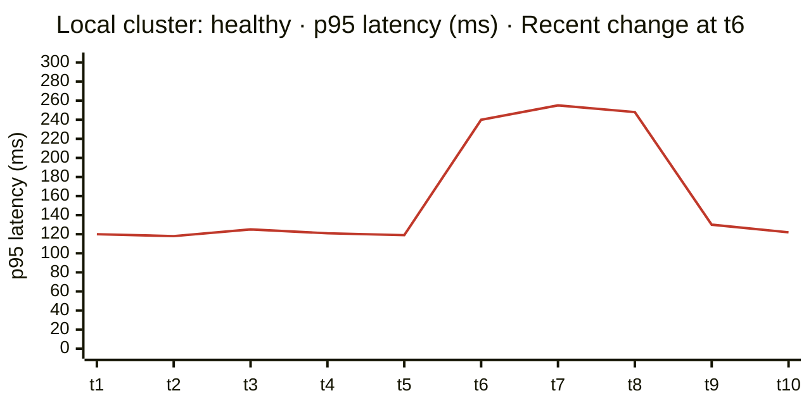

An engineer who changes code and then looks at a running system learns
something. An engineer who changes code and only looks at the code learns
much less. The same is true for agents, only more so. Without a running
environment and a way to observe it, an agent's only feedback is whether
the code compiles and whether its own tests pass. That is not enough
feedback to be trusted with anything that matters.

So I have come to think of environments and observability as **the agent's
senses**. The better they are, the more autonomy is safe.

The first sense is **an environment that matches production**. For us that
means running the same orchestration locally that runs in production: a
local Kubernetes cluster on a laptop or a development machine, with the
same manifests, the same service boundaries, and the same shape of
configuration. The point is
not perfect fidelity. Data, scale, and external integrations will always
differ. The point is that the usual classes of mistake show up on the
laptop rather than in staging or in front of a customer: a wrong port, a
missing environment variable, a service that assumes another one is
local, a migration that only works on an empty database.

This is an old lesson for me. When I worked on embedded devices, nothing
could be built without a good working local setup, and that setup was a
project in itself: development hardware and boards, kernel compilation,
all the way to RF shield rooms. We needed it to see what our code actually
did. *Agents need the same thing*, except that the setup is now a cluster
on a laptop instead of a lab.

The second sense is **observability, locally**. Production teams have long
used metrics, logs, and traces to understand a running system. It is less
common to give the same view to a developer, and rarer still to give it
to an agent. We run Grafana locally and trace requests locally, so
that when an agent changes a service, it can ask the same questions an on-call engineer would. Did latency change?
Did errors appear? Did a new query start running a thousand times per
request? The agent does not need to look at a dashboard to do this. It can
query the same metrics, logs, and traces that the dashboard reads.





The most useful habit this enables is simple: *measure before, change,
measure after*. Before the agent touches anything, it records how the
system behaves on the paths it is about to change. After the change, it
runs the same paths and compares. The diagram above shows what that looks
like when something goes wrong. Latency is flat, a change lands, and
latency doubles. Without the "before", that jump is just a number. With
it, it is a finding.

This changes the kind of evidence the agent returns. Instead of "the tests
pass", it can say "the tests pass, latency on this endpoint is unchanged,
error rates are unchanged, and here is the trace of one request through
the new path". That is evidence a reviewer can check quickly, and it is
much harder to get wrong by accident. **An agent that can see the system
can be asked to prove its change, not just describe it.**

There is a second benefit, and it reaches beyond engineering. When
environments are easy to start and observability is available locally,
people who are not backend engineers can use them too. A product manager
or a support lead can run the whole system, reproduce a customer's
problem, and look at the same view the engineers use. I will come back to
this in [chapter 8]({{ '/human-map-agent-hands/08-who-can-test/' | relative_url }}).

None of this is free. A local environment that matches production has to
be maintained like production, and it drifts if nobody owns it.
Observability locally needs the same discipline in instrumenting code as
observability in production. These are real costs, and I will return to
them in [chapter 11]({{ '/human-map-agent-hands/11-costs-nobody-budgets/' | relative_url }}). But in my experience they are smaller than the cost of
giving agents autonomy without senses, and much smaller than the cost of
finding agent mistakes in front of customers.

Senses tell the agent what happened. Tests tell it what was supposed to
happen. Those are different things, and both are needed.
