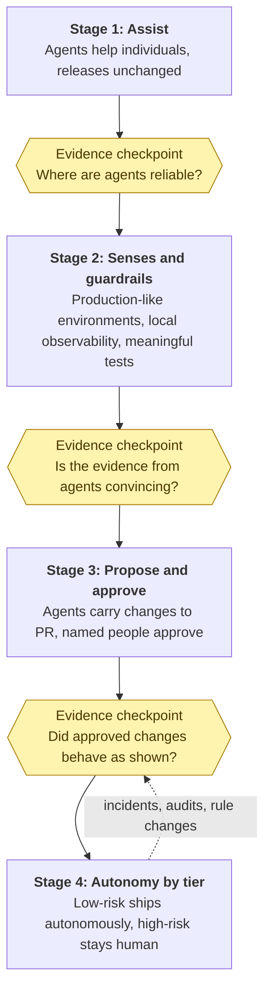

Our own path went through all three kinds of team. From a single
developer, to a team of experts, to pods, we worked the conventional,
orthodox way. The move toward agents did not start as a push from the top.
Some people were curious and began using AI on their own, and some started
presenting its work as their own. When the push from the top did come, it
leaned on what the orthodox way values most: we put a person at every step.
Then, as we built protocols like
[PROTO]({{ site.baseurl }}) and ran agentic
orchestration like the [pilot I described
earlier]({{ site.baseurl }}), our
confidence grew, and we moved closer to the fully agentic end. We do not
aim to be fully agentic. We aim to move more of our work into the
autonomous corner as the evidence earns it.

That path taught me that a team does not move by announcement. A memo that
says "we are now an agentic team" changes the tools and leaves the habits,
and the habits decide what happens. Moving a team is a sequence of small,
reversible steps, each justified by evidence from the step before. It is
the same lesson as growing a company, which I wrote about in [From
One-Person Engine to Multi-Layered
Machine]({{ site.baseurl }}):
the real work is managing each transition deliberately.





I think of it as four stages, with an **evidence checkpoint** between each.
In the first, agents assist individuals with work that never reaches
customers on its own, and nothing about releases changes. The checkpoint is
whether the team can name, from its own experience, where agent output can
be trusted and where it cannot. In the second, the team builds the map,
the senses, and the guardrails of chapters [3]({{ '/human-map-agent-hands/03-map-and-hands/' | relative_url }}), [5]({{ '/human-map-agent-hands/05-environments-and-observability/' | relative_url }}), and [6]({{ '/human-map-agent-hands/06-tests-as-guardrails/' | relative_url }}): production-like
environments, local observability, meaningful tests, and a map format
people actually use. The checkpoint is whether an agent can make a change
and return evidence that a reviewer finds convincing.

In the third stage, agents carry changes to pull requests and named people
approve them, with risk classes enforced in permissions and pipelines, as
[chapter 4]({{ '/human-map-agent-hands/04-autonomy-by-risk/' | relative_url }}) described. The checkpoint is whether approved changes behaved as
the evidence said, and whether reviewers were reviewing rather than
rubber-stamping. The fourth stage is where the grid is meant to lead. In
the low-risk corner, agents would ship without a person approving each
change, and people would review the record afterwards, while the
highest-risk actions stay human at every step. That stage is never
finished: every incident, audit, or change in the rules is a reason to
revisit a tier. The checkpoints also do a second job. Their evidence is the
same kind [chapter 7]({{ '/human-map-agent-hands/07-regulation-and-audit/' | relative_url }}) described for auditors and regulators, so a team that
adopts agents this way builds its audit trail as it goes.

Where are we? For production, we are at stage three: agents do much of the
work, and people approve what ships. No production deployment is fully
autonomous yet. Below production, we are further along. For some projects,
changes to development and UAT deploy automatically, and on the local setup
agents have full autonomy. As [chapter 4]({{ '/human-map-agent-hands/04-autonomy-by-risk/' | relative_url }}) described, for us autonomy follows
the environment before it follows the change.

A few things I have learned along the way. Start with willing people on
low-risk work, and let their results do the persuading; in my experience,
evidence from a colleague persuades engineers more than advice from
leadership does. A pod, with a couple of developers, a product manager, and
a QA engineer, is a natural unit for this, because it has every role the
stages need. Keep the cautious voices in the room. The people most wary of
agents are often the ones who remember why a rule exists, and they make
the map better. Measure what reaches customers, not what is generated: how
often a change has to be rolled back, and how long review takes compared
with how much it finds, say more than the number of pull requests. And
expect roles to change, and say so honestly. The work shifts toward
writing maps, reviewing evidence, and owning environments. That is a
change in what people do, not in whether they are needed, as I told
students in [Dont Fear AI, Learn to Engineer With
It]({{ site.baseurl }}).

Adoption also needs a way back. If the evidence at a checkpoint is weak,
the honest response is to stay where you are, or step back, and fix what
is missing. A team that can only move forward is not adopting a practice.
It is following a fashion.
