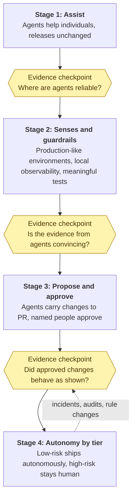

If the mix is the goal, how does a team get there? Not by announcement. A
memo that says "we are now an agentic team" changes the tools and leaves
the habits, and the habits decide what actually happens. In my experience,
moving a team is a sequence of small, reversible steps, each one justified
by evidence from the step before. It is the same lesson as growing a
company, which I wrote about in [From One-Person Engine to Multi-Layered
Machine]({{ site.baseurl }}):
the real work is managing each transition deliberately.





I think of it as four stages, with an **evidence checkpoint** between each.

*Stage one: assist.* Agents help individuals with work that never reaches
customers on its own: explaining unfamiliar code, drafting tests,
summarising logs, writing internal documentation. Nothing about the
release process changes. The purpose of this stage is to build familiarity
and to learn where the tools are reliable and where they are not. The
checkpoint before moving on is simple: can the team name, from its own
experience, the kinds of task where agent output can be trusted and the
kinds where it cannot?

*Stage two: build the senses and the guardrails.* Before agents get more
autonomy, the team invests in what makes autonomy safe: an environment
that matches production, local observability, a test suite that states
real business rules, and a written map format that people actually use.
These are chapters [4]({{ '/human-map-agent-hands/04-map-and-control/' | relative_url }}), [6]({{ '/human-map-agent-hands/06-environments-and-observability/' | relative_url }}), and [7]({{ '/human-map-agent-hands/07-tests-as-guardrails/' | relative_url }}) of this essay, and agents can do much of
the work themselves. The checkpoint: can an agent make a change, run it in
a realistic environment, and return evidence that a reviewer finds
convincing?

*Stage three: propose and approve.* Agents now carry changes from map to
pull request, with tests and evidence, and named people approve before
anything reaches customers. Risk classes are assigned to parts of the
system and enforced in permissions and pipelines, as [chapter 5]({{ '/human-map-agent-hands/05-autonomy-by-risk/' | relative_url }}) described.
The checkpoint: over a meaningful period, did approved agent changes
behave as the evidence said they would, and did reviewers feel they were
reviewing rather than rubber-stamping?

*Stage four: autonomy by tier.* In the low-risk corner of the grid, agents
ship without a person approving each change, and people review the record
afterwards. Everywhere else, propose and approve continues, and the
highest-risk actions remain human at every step. This stage is never
finished, and so its checkpoint never ends. Every incident, every audit,
and every change in the rules is a reason to ask whether an area belongs
in a different tier.

The checkpoints do a second job. The evidence a team gathers to decide
whether to move forward is the same kind of evidence [chapter 9]({{ '/human-map-agent-hands/09-regulation-and-audit/' | relative_url }}) described
for auditors and regulators. *A team that adopts agents this way builds
its audit trail as it goes*, instead of trying to reconstruct one later.

Where are we? For production, we are at stage three: agents do much of the
work, and people approve what ships. No production deployment is fully
autonomous yet. Below production, we are further along. For some projects,
changes to development and UAT deploy automatically, and on the local setup
agents have full autonomy. As [chapter 5]({{ '/human-map-agent-hands/05-autonomy-by-risk/' | relative_url }}) described, for us autonomy follows
the environment before it follows the change.

Some things I have learned to watch for, offered as my experience rather
than as rules. **Start with willing people on low-risk work**, and let
their results do the persuading. A pod is a natural unit for this. With a
couple of developers, a product manager, and a QA engineer, it has every
role the stages need, from writing the map to checking the evidence, and
its results are easy for other pods to see. In my experience, evidence from a
colleague persuades engineers more than advice from leadership does.
**Keep the cautious voices in the room.** The people most wary of agents
are often the ones who remember why a rule exists, and they make the map
better. **Measure what reaches customers, not what is generated.** More
code, more pull requests, and more tests are not outcomes. How often a
change has to be rolled back, and how long review takes compared with how
much it finds, say more. **Expect roles to change, and say so honestly.**
The work shifts toward writing maps, reviewing evidence, and owning
environments. That is a change in what people do, not in whether they are
needed, and it deserves support and training, not surprise. I said the
same to students in [Dont Fear AI, Learn to Engineer With
It]({{ site.baseurl }}):
some roles will evolve, but that does not mean the end of engineering.

Adoption also needs a way back. Every stage should be reversible. If the
evidence at a checkpoint is weak, the honest response is to stay where you
are, or step back, and fix what is missing. *A team that can only move
forward is not adopting a practice. It is following a fashion.*
